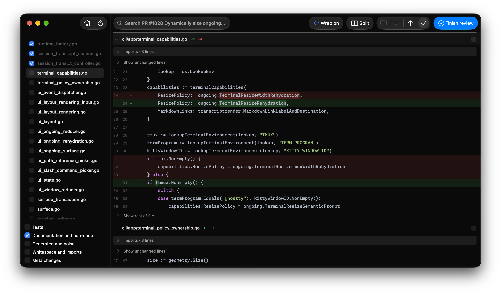
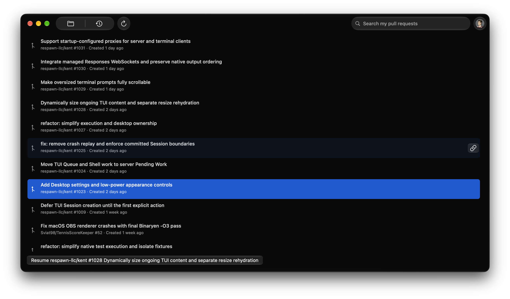

McDiff is a native macOS tool for reviewing agent-written code that skips noise.

Spend your attention on the agent's decisions, not its formatting. Set aside generated files, import churn, whitespace, and other changes you choose to skip.



## Review the next revision without starting over

Files you already reviewed stay checked until their diff changes. Finish a round, send your feedback, and come back to the agent's next attempt without rereading unchanged work or carrying old comments into the new round.

## Give the agent actionable feedback

Attach comments to the lines that need work, then copy your review into the agent's conversation. Your feedback travels with file paths and line ranges, so you spend less time explaining where the problem is.

## Keep your place

Review local changes or a GitHub pull request without switching branches or disturbing your working files. Find your open pull requests across repositories in one place, and return to an unfinished review where you left off.



## More ways to focus your review

- Skip tests, documentation, Markdown, and other non-code files.
- Set aside generated files, whitespace-only edits, and file metadata changes.
- Focus your review on production code.
- Keep imports and unchanged lines collapsed until you want the context.
- Keep review comments and progress local on your Mac.
- Copy your review as Markdown to send to a coding agent.
- Sign in to GitHub with credentials stored in macOS Keychain.
- Read changes side by side or in a unified diff.
- Leave multiline comments on the code that needs attention.
- Follow code with syntax highlighting and word-level change emphasis.
- Read Markdown as formatted documents.
- Save your place across reviews and return for the next revision.
- Find and navigate your open pull requests across repositories.

## Install

Requires macOS 26 or later.

```sh
brew install --cask Nek-12/tap/mcdiff
```

Or download the ZIP from [GitHub Releases](https://github.com/Nek-12/mcdiff/releases/latest), extract it, and move McDiff to Applications.

Licensed under [Apache-2.0](LICENSE).
